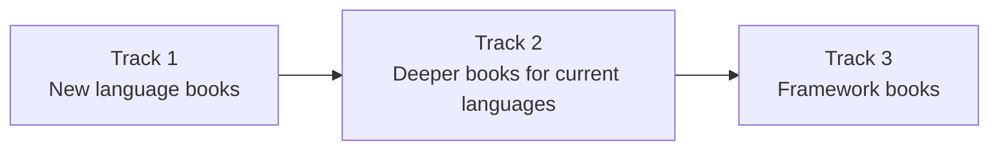

# Scope and future plans

This page lists what Pip & Friends covers today and what is planned next. The plans can change, and [book requests](https://github.com/shriyansh24/pip-and-friends/issues/new?template=book-request.yml) help decide the order.

## Current scope

| Book | Chapters | Status |
|------|---------:|--------|
| Python | 27 | Complete |
| Rust | 29 | Complete |
| Go | 28 | Complete |
| C++ | 29 | Complete |
| JavaScript | 29 | Complete |

Every book is for complete beginners and starts from zero.

## Planned work

The plans fall into three tracks. Each track follows the same rules as the current books: real runs, checked exercises, art drawn in code and one guide character per book.

### Track 1: New language books

| Book | Topics | Why it fits next |
|------|--------|------------------|
| Java | types, classes, interfaces, collections, exceptions, generics, streams, threads | Java is the most common language in schools and large companies. |
| C | types, pointers, arrays, strings, memory, structs, files, the build process | C explains what the C++ and Rust books build on. |
| TypeScript | types, interfaces, unions, generics, narrowing, modules, the compiler | TypeScript continues straight on from the JavaScript book. |

Each new book needs:

1. A guide character drawn in the house style.
2. A chapter plan in `source/tools/plans/`.
3. A toolchain for `capture.py`, with a primary and a secondary version.
4. Around 28 chapters, each one passing `check_chapter.js`.

### Track 2: Deeper books for current languages

The current books stop at the level of a confident beginner. A second book for each language would take readers to an intermediate level.

| Language | Topics for a second book |
|----------|--------------------------|
| Python | packaging, typing, async, decorators in depth, performance, a larger project |
| Rust | advanced traits, macros, unsafe code, async runtimes, a larger project |
| Go | generics, context, profiling, networking, a larger project |
| C++ | move semantics in depth, templates and concepts, modules, concurrency, a larger project |
| JavaScript | modules and bundlers, the network, testing, performance, a larger project |

### Track 3: Framework books

Framework books assume the reader has finished the matching language book. The candidates are:

| Framework | Language book it builds on |
|-----------|----------------------------|
| React | JavaScript or TypeScript |
| Node.js and Express | JavaScript or TypeScript |
| Django or FastAPI | Python |
| Spring Boot | Java |

The first framework book will be chosen from book requests and reader feedback.

## Out of scope

- **Video lessons.** The books stay as comics you read at your own pace.
- **Accounts and servers.** Progress stays in your browser.
- **Hand-typed output.** No page will show output that did not come from a real run.

## Suggest a change

Open a [book request](https://github.com/shriyansh24/pip-and-friends/issues/new?template=book-request.yml) to suggest a book, a topic or a different order. [CONTRIBUTING.md](CONTRIBUTING.md) explains how to help write a book.
